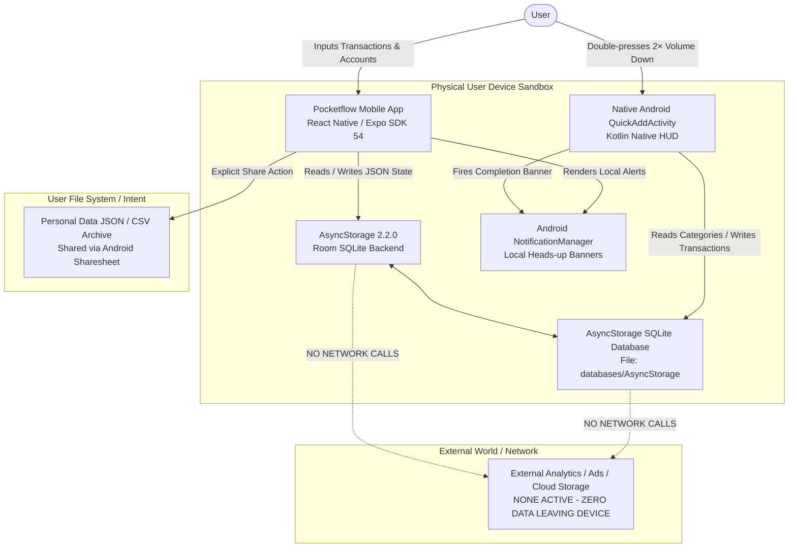

# Pocketflow Finance — Data Flow Architecture

**Document Reference**: DPDP Founder Guide (September 2026) / Digital Personal Data Protection Act, 2023  
**Status**: Verified Codebase Audit  
**Date**: September 2026  

---

## 1. Data Flow Diagram

---

## 2. Detailed Step-by-Step Data Movements

### Flow 1: In-App Expense Logging
1. **User Action**: User enters amount, description, category, and account in `app/(tabs)/index.tsx` or `add-transaction.tsx`.
2. **Execution Context**: React Native JS thread within `FinanceContext.addTransaction`.
3. **Data Written**: New transaction object with UUID, timestamp, amount, categoryId, accountId.
4. **Storage Destination**: `@pocketflow/transactions` key in local device storage.
5. **Side-Effect**: Account balance updated in memory and committed to `@pocketflow/accounts`.
6. **Network Transmission**: **None.** No network packets are emitted.

### Flow 2: Instant Quick Add (2× Volume Down or Tile)
1. **User Action**: User double-presses physical Volume Down button anywhere on Android.
2. **Native Trigger**: `QuickAddAccessibilityService` detects key event and launches `QuickAddActivity`.
3. **Native HUD**: Displays isolated translucent 3-step HUD (`AMOUNT` -> `DESCRIPTION` -> `CATEGORY`).
4. **Storage Execution**: `StorageHelper.saveTransaction` opens the local SQLite database (`databases/AsyncStorage`), parses the JSON array, prepends the new transaction, and writes back within a native SQLite transaction.
5. **Notification**: `NotificationManager` displays an on-device heads-up banner: *"New Expense — Your expenses have been tracked!"*.
6. **Network Transmission**: **None.** Operation is executed 100% offline.

### Flow 3: Personal Data Download (DPDP Right to Access / Portability)
1. **User Action**: User taps "Download My Data" in `app/privacy-and-data.tsx`.
2. **Context Execution**: `FinanceContext.downloadPersonalDataArchive` collects:
   - User profile (name, avatar presence)
   - All accounts and balances
   - All transactions
   - Categories and savings goals
   - Consents, privacy requests, and nominee declarations
   - Standard export metadata (timestamp, policy version, DPDP disclaimer)
3. **Security Filter**: Passwords, tokens, API keys, or service credentials are never included.
4. **Output**: System Share Sheet opens (`Share.share`), allowing user to save the `.json` file to local Downloads or send to their personal email.

### Flow 4: Permanent Data Deletion (DPDP Right to Erasure)
1. **User Action**: User confirms deletion by typing "DELETE" in `app/privacy-and-data.tsx`.
2. **Storage Execution**: `FinanceContext.purgeAllUserData`:
   - `AsyncStorage.multiRemove` purges all `@pocketflow/*` storage keys.
   - Resets all in-memory React context states to clean default values.
   - Cleans native SQLite storage.
   - Records single non-financial `deletion_completed` audit event.
3. **Network Transmission**: **None.** Because no remote servers hold user data, deletion on the device is complete and immediate.

---

## 3. Data Residency & Cross-Border Inspection
- **Does personal data leave the user's phone?** No.
- **Does personal data cross Indian borders?** No.
- **Are cloud databases syncing data?** No cloud sync is active in the current release. All data residency is strictly local to the device.

